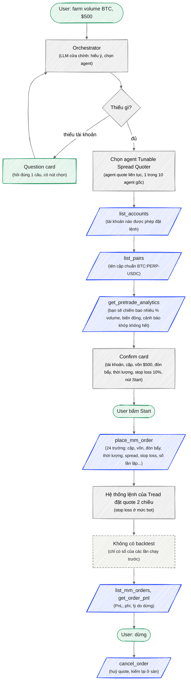
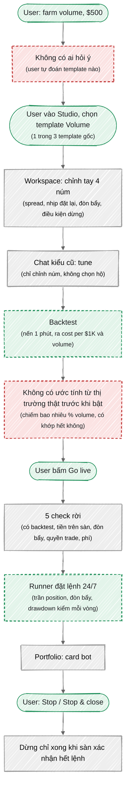
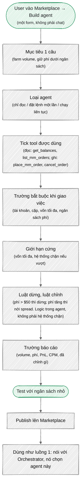
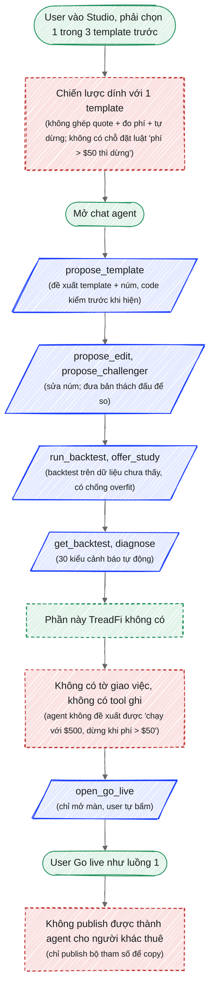
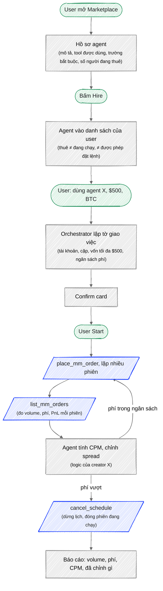
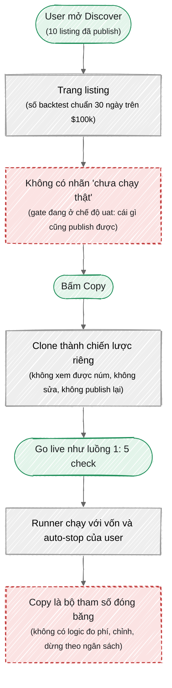
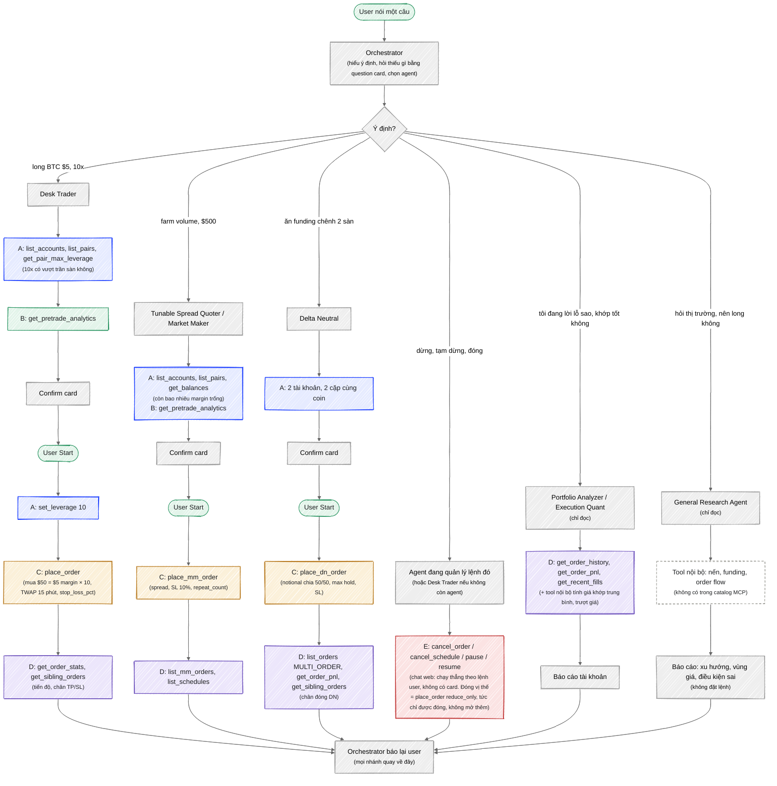
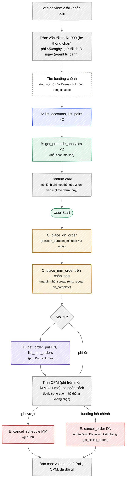

# 24. R3: luồng agent TreadFi vs Quantpets

> Đầu ra của [[r3-harness-research]], 9/11/2026. Bản chữ của hai artifact: [Harness 11 tầng](https://claude.ai/artifact/TJVJhr27bhHPsY9pC4CmEc) và [Ba luồng user](https://claude.ai/artifact/3i5YmsNxkosdV8XpXrq196). Sơ đồ dưới là mermaid, Obsidian tự vẽ (kiểu vẽ tay chỉ hiện trên artifact). Ô đỏ nét đứt = Quantpets thiếu, ô xanh nét đứt = Quantpets hơn, ô xanh dương = tool thật của TreadFi.

## 0. Năm từ cần biết

- **agent**: một "nhân viên" AI có bộ tool riêng. TreadFi có 10 agent gốc, cộng agent do user tạo trên marketplace.
- **tool**: một việc agent được gọi, có form cố định (tên, trường bắt buộc, trần). Tên tool trong trang là tên thật trong catalog TreadFi.
- **mandate**: tờ giao việc cho agent: tài khoản, cặp, vốn tối đa, mục tiêu. Agent chỉ được làm trong tờ này.
- **CPM**: cost per million, phí bỏ ra cho mỗi $1M volume. Số quan trọng nhất khi farm.
- **D23**: quyết định của Duy (30/10): agent Quantpets không bao giờ bật bot hay đặt lệnh, chỉ đề xuất.

TreadFi chưa có Lighter nên ví dụ bên TreadFi chạy trên Hyperliquid, Quantpets trên Lighter. Cùng một bài: người mới có $500, muốn farm volume.

## 1. Dùng chiến lược có sẵn

Ví dụ: "Tôi có $500, farm volume BTC perp giúp tôi."

### TreadFi

- **1 lớp LLM**: Orchestrator đứng trên, user nói một câu. Agent con và tool nằm dưới, user không phải biết.
- **ước tính trước**: Pretrade là một tool đọc riêng, guide bắt gọi trước khi đặt.
- **duyệt 1 lần**: Một thẻ, đủ số, một nút. Sau Start agent theo dõi và báo.
- **lưu ý nguồn**: Luồng này là chat trong app (đã thấy khi Max long BTC). Tên tool lấy từ catalog MCP; qua MCP thì không có Orchestrator, LLM ngoài tự gọi tool.

### Quantpets (hôm nay)

- **thiếu lớp trên**: User phải tự chọn template, tự chỉnh núm. Người mới không biết Volume khác Low risk ở đâu.
- **thiếu ước tính**: Trước khi bật chỉ có số backtest từ nến. Hai template MM dính stop 5% ngay ngày đầu, nên số này chưa tin được.
- **hơn**: Có backtest. Trần rủi ro mức tài khoản nằm trong runner, TreadFi qua MCP không có.
- **6 màn**: Studio → núm → chat → backtest → Go live → 5 check. TreadFi: nói 1 câu, trả lời 1 card, bấm 1 nút.

### Nên làm như TreadFi

1. **Một câu hỏi đầu vào thay cho picker.** User gõ "farm volume $500", agent chọn template Volume, điền núm, hiện 1 card. (giải thích: harness v1 đã có tool `propose_template` làm đúng việc này, nhưng chat agent đang ẩn sau `?chat=agent`. Chỉ cần bật mặc định.)
2. **Một card duyệt thay cho 5 check rời.** Card ghi: template, vốn, cost per $1K từ backtest, cảnh báo, nút Start. (giải thích: 5 check giữ nguyên, gom vào một thẻ. Để agent được mở thẻ này thì D23 phải đổi.)
3. **Tool ước tính từ thị trường thật.** Trả: chiếm bao nhiêu % volume, có khớp hết không, phí dự kiến. (giải thích: TreadFi có `get_pretrade_analytics`. Quantpets đọc được sổ lệnh sàn qua adapter sẵn có, thiếu tool gói lại.)

## 2. Tự tạo chiến lược riêng

Ví dụ, cùng đề bài hai bên: "Bot farm volume, tự giảm spread khi phí vượt ngân sách, dừng khi vượt $50 phí."

### TreadFi: tạo agent riêng

- **agent = tool + tờ giao việc**: Không viết code. Tick tool có sẵn, khai trường bắt buộc, đặt trần.
- **ghép được**: Một agent dùng nhiều tool: đặt quote, đọc phí, huỷ. Không bị dính vào một loại bot.
- **chưa thấy UI**: Orchestrator tự nhận "chưa có tài liệu builder chi tiết". Các bước trên là khung nó mô tả, cần vào Marketplace bấm thử.

### Quantpets: tạo chiến lược trong AI Studio

- **hơn**: Harness v1 có backtest, bản thách đấu, chống overfit, cảnh báo bằng code. TreadFi không có backtest.
- **dính template**: Studio bắt chọn template trước, chat chỉ chỉnh núm của template đó. Đề bài "tự giảm spread khi phí vượt ngân sách" không có chỗ đặt.
- **agent không có việc**: Hết cảnh báo là hết. Không có tờ giao việc (vốn, trần, mục tiêu) nên không có gì để agent chạy tiếp.

### Nên làm như TreadFi

1. **Vào bằng câu hỏi, không bằng picker.** Studio mở chat trước, agent gọi `propose_template`, rồi mới hiện pet tương ứng. (giải thích: đảo thứ tự 2 màn, không cần code mới.)
2. **Tờ giao việc là một form, không phải câu chat.** Tài khoản sàn, template, vốn tối đa, drawdown tối đa, ngân sách phí. (giải thích: TreadFi chỉ chặn cứng vốn tối đa. Quantpets đã có trần trong runner, chỉ cần nối form này vào đó.)
3. **Sau v0: cho một chiến lược có luật chỉnh và luật dừng theo phí.** (giải thích: đây là cái làm "farm, as required." khác một bot MM thường. Quantpets có 3 template rời nhau. Việc lớn, để track chiến lược T5 quyết.)

## 3. Dùng chiến lược của người khác (marketplace)

Ví dụ: creator X đã đăng "bot farm volume BTC". Bên TreadFi đó là một agent để thuê, bên Quantpets đó là một listing để copy. Khác nhau này là bản chất, không phải do chọn ví dụ.

### TreadFi: thuê agent

- **thuê = thêm năng lực**: Agent thuê về chạy trên tài khoản và trần của bạn, vẫn hỏi bạn trước khi đặt.
- **có vòng lặp**: Agent của người khác mang theo logic: đo, so, chỉnh, dừng. Không chỉ là một bộ tham số.

### Quantpets: copy listing

- **đúng chuẩn**: Copy chạy trên sàn và vốn của người copy, không xem được núm của creator.
- **copy ≠ thuê**: Copy là chụp tham số. Thuê là mang về một agent có vòng lặp. Người mới copy xong vẫn phải tự canh.
- **không biết listing đã chạy thật chưa**: Production để gate `uat`, publish từ backtest, không nhãn.

### Nên làm như TreadFi

1. **Nhãn trên listing: "đã chạy thật N ngày" hoặc "chỉ backtest".** (giải thích: gate có sẵn 3 chế độ, chỉ thiếu nhãn trên card. Quyết định bỏ nhãn (PD-21, 31/10) Duy ghi "Bean và Frank đã duyệt", Max cần xác nhận với Frank.)
2. **Copy xong mở thẳng card duyệt, không đi lại Studio.** (giải thích: TreadFi thuê xong là nói với Orchestrator được ngay.)
3. **Sau v0: listing kèm luật chạy (ngân sách phí, khi nào dừng).** (giải thích: bước biến copy thành thuê. Cần tool ghi và cổng kiểm ở trang Harness trước.)

## Tóm lại

## Nguồn
- `sources/research/2026-11-09-treadfi-mcp-tools.md`, `2026-11-09-treadfi-mcp-guide.md` (catalog MCP thật, 29 tool)
- `sources/research/2026-11-08-treadfi-agent-task-chat.md`, `-2.md` (2 phiên chat của Max với Orchestrator)
- `docs/19-product-map.md`, `docs/15-tool-layer-scorecard.md`, `docs/14b-q2-agent-execution-sheets.md`
- Ảnh: `docs/assets/harness/`
---

# Phần B. Bản đồ catalog TreadFi (9/11)

> Bản chữ của artifact [Bản đồ catalog](https://claude.ai/artifact/4F1DsqhhDziTDU7qpusX5U). Trả lời 3 câu: user muốn gì thì đi qua tool nào; agent phức tạp đi qua nhiều tool thì sao; thuê agent thì catalog đổi gì.

## B1. Catalog: 29 tool, 6 nhóm

**A. Tài khoản và cặp** (6 tool)
- `list_accounts`tài khoản nào, sàn nào, được đặt lệnh hay chỉ xem
- `list_pairs`tìm tên cặp chuẩn trên sàn, gõ sai vẫn ra
- `get_balances`margin trống, margin đang dùng, equity
- `get_leverage`đòn bẩy đang đặt cho cặp
- `get_pair_max_leverage`đòn bẩy tối đa sàn cho phép
- `set_leverage` WRITEđổi đòn bẩy

**B. Ước tính trước** (2 tool)
- `get_order_book`sổ lệnh đầu bảng, spread hiện tại
- `get_pretrade_analytics`lệnh này sẽ chiếm bao nhiêu % volume, biến động, cảnh báo khớp không hết. Guide bắt gọi trước khi đặt

**C. Đặt lệnh** (5 tool, toàn WRITE)
- `place_order`1 lệnh, chọn cách rải lệnh theo thời gian (8 kiểu, ví dụ TWAP = chia đều theo phút), có TP/SL
- `place_mm_order`bot quote 2 chiều, lặp được, lịch được
- `place_dn_order`bot 2 chân long/short trên 2 tài khoản, có max hold
- `place_multi_order`nhiều lệnh cùng lúc trên 1 tài khoản
- `place_chained_order`chuỗi lệnh chạy lần lượt theo thứ tự

**D. Theo dõi** (10 tool)
- `list_orders`lệnh đang sống (30 ngày gần nhất)
- `get_order_history`lệnh đã xong, huỷ, hết hạn
- `get_order_stats`1 lệnh đi tới đâu: khớp bao nhiêu, phí
- `get_order_pnl`PnL một lần chạy bot MM hoặc DN
- `list_mm_orders`cả lịch sử bot MM một lần gọi: PnL, phí, lý do dừng
- `list_schedules`lịch nào sắp nổ, đã chạy mấy lần
- `get_working_orders`các lệnh con đang treo của một bot
- `get_recent_fills`từng lần khớp: giá, số lượng, phí
- `get_sibling_orders`lệnh đi kèm: TP, SL, lệnh đóng DN
- `get_order_details`dán link lệnh vào là ra chi tiết

**E. Điều khiển** (4 tool, toàn WRITE)
- `cancel_order`huỷ 1 lệnh hoặc 1 bot. Không dừng lịch lặp
- `cancel_schedule`dừng lịch MM và đóng phiên đang chạy. Chỉ cho lịch MM, lịch DN bị từ chối
- `pause_order` / `resume_order`tạm dừng, chạy tiếp

**F. Thi đấu** (2 tool)
- `list_competitions`giải nào đang mở, đã đăng ký chưa
- `get_competition_board`bảng xếp hạng một giải

**Không có trong catalog: dữ liệu thị trường.** Không có tool đọc nến, funding, chỉ báo, order flow, ví người khác, Polymarket. Cũng không có tool chuyển tiền giữa Tread Wallet và sàn, dù chat có làm được. Nghĩa là **catalog MCP chỉ là phần thực thi và tài khoản**. Các agent phân tích (General Research, Execution Quant, Portfolio Analyzer, Prediction Analyst, HyperTracker) dùng một bộ tool khác trong app mà ta không nhìn thấy qua MCP. Khi vẽ các luồng dưới, phần đó ghi là "tool nội bộ, không thấy".

## B2. Luồng tổng: user muốn gì thì đi qua nhóm nào

Một sơ đồ cho mọi case. Orchestrator (con tiếp tân nhận câu hỏi, chọn agent) rẽ theo ý định. Question card = thẻ hỏi có nút chọn; confirm card = thẻ xác nhận trước khi đặt lệnh. Mỗi nhánh ghi agent nào làm và đi qua nhóm tool nào (chữ A đến F theo mục 1).

- **cùng một khung**: Mọi nhánh đặt lệnh đi A → B → card → C → D. Khác nhau chỉ ở tool C nào và trường nào. Đây là cái "có standard" mà bạn tìm.
- **chỉ đọc = không qua C**: Research, Portfolio, Execution Quant không bao giờ chạm nhóm C. Không có cách nào từ báo cáo nhảy thẳng sang lệnh.
- **nhánh dừng là riêng**: Orchestrator tìm agent đang giữ lệnh đó rồi chuyển việc, để hai agent không cùng đụng một vị thế.
- **ngoài sơ đồ**: Nhóm F (giải thi đấu) Orchestrator trả lời thẳng, không agent nào trong 10 con. Polymarket và thể thao đi qua Prediction Analyst, Sports Consultant bằng tool nội bộ.
- **catalog không có B cho DN**: Pretrade chỉ nhận 1 cặp. DN 2 chân không có ước tính gộp; agent phải gọi 2 lần hoặc bỏ qua.

## B3. Bảng case: muốn gì thì gọi tool nào

| User muốn | Agent | Thứ tự tool | Trường quan trọng |
|---|---|---|---|
| Nên long BTC không? | General Research | tool nội bộ (nến, funding, order flow) → báo cáo | không có lệnh |
| Long BTC $5, 10x | Desk Trader | `list_accounts` → `list_pairs` → `get_pair_max_leverage` → `get_pretrade_analytics` → card → `set_leverage` → `place_order` → `get_order_stats` → `get_sibling_orders` | set_leverage 10 trước; quote_asset_qty 50 ($5 margin × 10), strategy TWAP, duration_minutes 15, stop_loss_pct |
| Farm volume $500 | Tunable Spread Quoter (liên tục) hoặc Market Maker (một phiên) | A → `get_pretrade_analytics` → card → `place_mm_order` → `list_mm_orders` → `cancel_schedule` | margin_usd 500, leverage, duration_minutes, default_spread_bps, stop_loss_pct 10, repeat_count, pov_preset |
| Ăn funding chênh HL và Ondo | Delta Neutral | `list_accounts` (1 lần, ra cả 2 tài khoản) → `list_pairs` (1 lần, 2 sàn) → card → `place_dn_order` → `list_orders` → `get_order_pnl` → `get_sibling_orders` | long_pair, short_pair, 2 account, notional_usd, duration_minutes, position_duration_minutes, dn_stoploss_percent |
| Mua $1,000 chia 3 đợt, đợt sau chỉ chạy khi đợt trước xong | Desk Trader | A → B → card → `place_chained_order` → `get_order_stats` (có current_leg) | legs theo thứ tự ưu tiên |
| Mỗi sáng 6h chạy bot MM 2 giờ, 7 ngày | Market Maker | card → `place_mm_order` với start_datetime + repeat_trigger daily → `list_schedules` | repeat_count 7, repeat_trigger daily |
| Tôi lời lỗ sao tuần này? | Portfolio Analyzer | `get_order_history` → `get_order_pnl` từng run → `get_recent_fills` | after/before, statuses |
| Lệnh này khớp có tốt không? | Execution Quant | `get_order_details` (dán link) → `get_recent_fills` → tool nội bộ tính VWAP, slippage | ref = link lệnh |
| Đóng hết, dừng hết | agent đang giữ lệnh | `list_orders` → `cancel_schedule` (lịch MM) → `cancel_order` (từng bot, DN) → `place_order` reduce_only (đóng vị thế) | cancel một run không dừng lịch; cancel_schedule không nhận lịch DN; đóng vị thế là một lệnh ngược, không phải cancel |
| Mua ETH và SOL cùng lúc, rải 1 giờ | Desk Trader | A → B ×2 → card → `place_multi_order` → `get_working_orders` (lệnh con nào đang treo) | legs, strategy TWAP, duration_minutes 60 |
| Sắp ra tin, tạm dừng bot rồi chạy lại | agent đang giữ bot | `list_orders` → `pause_order` → `resume_order` | target_kind, target_id |
| Tôi đứng hạng mấy trong giải? | Orchestrator trả lời thẳng | `list_competitions` → `get_competition_board` | slug |
| Đổi đòn bẩy cặp X lên 5 | Desk Trader | `get_pair_max_leverage` → card → `set_leverage` | account_id, pair, leverage |
| Ví nào trên HL đang thắng? | HyperTracker | tool nội bộ (ví công khai) |  |

Hai dòng "tool nội bộ" là việc agent làm bằng bộ tool không có trong catalog MCP. Còn lại 29 tool đều xuất hiện ít nhất một lần.

## B4. Agent phức tạp: một agent đi qua nhiều nhóm

Ví dụ: "Farm funding + volume": tìm cặp có funding chênh, mở DN, chạy MM trên chân long để lấy thêm volume, đo phí mỗi giờ, phí vượt ngân sách thì thu hẹp, hết funding thì đóng cả hai.

- **ghép = gọi nhiều tool C**: Không có tool "DN + MM". Agent gọi `place_dn_order` rồi `place_mm_order`, hai run riêng, agent tự giữ quan hệ giữa chúng.
- **vòng lặp là của agent**: Đo, so, chỉnh, dừng là prompt và logic của người tạo agent. Hệ thống chỉ chặn cứng vốn tối đa và tài khoản.
- **chỗ yếu**: Hai run không biết nhau. DN dừng mà MM còn chạy thì thành vị thế một chiều. Agent phải tự huỷ MM trước, hệ thống không làm hộ.
- **thiếu dữ liệu**: Catalog không có funding, nên bước tìm cặp phải nhờ tool nội bộ hoặc nguồn ngoài.
- **gọi lại không đặt trùng**: Mỗi lệnh ghi có một mã riêng. Vòng lặp mỗi giờ gọi lại cùng mã thì không tạo lệnh thứ hai; hệ thống trả "retryable" thì chờ rồi gọi lại cùng mã.

## B5. Thuê agent trên marketplace: catalog có đổi không

Không. Thuê chỉ đổi **ai viết luật** và **ai điền mandate**. Tool vẫn là 29 tool, chạy trên tài khoản và trần của người thuê.

|  | Agent gốc (10 con) | Agent tự tạo | Agent thuê trên marketplace |
|---|---|---|---|
| Tool dùng | 29 tool + tool nội bộ | chọn trong 29 tool (không thêm được) | bộ tool người tạo đã tick, đọc được trong hồ sơ |
| Luật chạy | Tread viết | bạn viết | người tạo viết, bạn không sửa được |
| Mandate (tờ giao việc) | Orchestrator hỏi bạn | bạn khai trường bắt buộc (ví dụ ngân sách phí, giữ tối đa là trường đề xuất; TreadFi chỉ chắc chắn chặn `total_margin_cap_usd`), Orchestrator hỏi bạn | trường bắt buộc do người tạo khai, Orchestrator hỏi bạn |
| Tiền và key | luôn là tài khoản của bạn. Người tạo agent không chạm được. Chỉ vốn tối đa là hệ thống chặn cứng | (như trái) | (như trái) |
| Xác nhận | chat web: tool C (đặt lệnh) qua confirm card; tool E (huỷ, dừng) chạy thẳng khi user ra lệnh. Thuê không bỏ được thẻ này. Qua MCP không có thẻ nào | (như trái) | (như trái) |
| Ví dụ | Desk Trader, Delta Neutral, Tunable Spread Quoter | agent "funding + volume" ở mục 4 | "farm, as required." (8 người thuê, bản v3, theo ảnh tweet 6/9 trong docs/14b) |

## B6. Ghi chú cho Quantpets

1. **Nhóm A, D, E Quantpets đã có trong phần chạy lệnh (runner), nhưng agent chưa gọi được.** (giải thích: chưa có tool ghi và chưa có cổng kiểm trước tool ghi. Xem trang Harness.)
2. **Nhóm B thiếu hẳn: không có ước tính từ sổ lệnh thật trước khi bật.** (giải thích: chỉ có backtest từ nến.)
3. **Luồng tổng của Quantpets sẽ ngắn hơn:** user nói một câu → agent chọn 1 trong 3 template (Volume ≈ place_mm_order, Low risk ≈ place_dn_order, High ≈ place_order có rule) → ước tính → 1 thẻ → Start → runner → pet. Một Orchestrator nhỏ rẽ 4 nhánh (tạo, sửa, xem, dừng) là đủ cho v0; không cần 10 agent.
