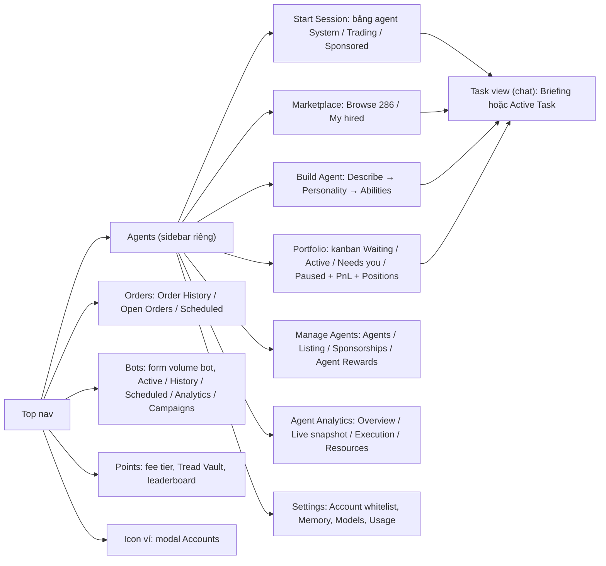
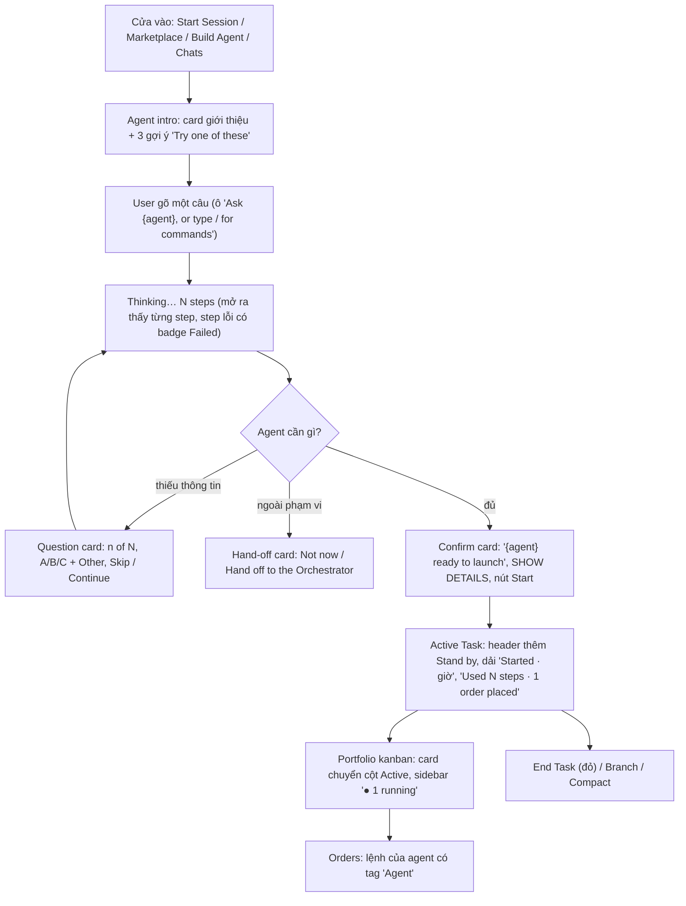

# TreadFi qua video 11/11: luồng chính, luồng phụ, và bảng component

Nguồn: video quay màn hình của Max `~/Movies/2026-11-11 16-28-19.mp4` (42 phút, không tiếng), tách 629 khung (4 giây một khung), 4 agent đọc và ghi log: `../sources/research/2026-11-11-treadfi-video-log-part1..4.md`. 28 ảnh mẫu đã lưu `assets/ui-flow/treadfi/treadfi-NN-*.png` (số frame ghi trong log để tra thêm). Viết 11/11.

## 0. Max đã đi những gì, và kết quả

| Phút | Việc | Kết quả |
| --- | --- | --- |
| 0 đến 3 | Dashboard, Points, mở 2 task cũ, Start Session, hỏi "what are you" với 6 system agent | Mỗi agent trả bảng năng lực. Chỉ Orchestrator có badge Active Task và nút Stand by, agent khác là Briefing |
| 3 đến 11 | Dùng agent sẵn `farm, as required.` (Sponsored, của @david): "hướng dẫn cách farm" → bộ 5 question card → chọn Ondo LP | **Khựng:** chưa cấp quyền tài khoản Ondo → hand-off card "This is outside farm's lane / Hand off to the Orchestrator". Vào Settings, Account whitelist chỉ có Tread Hyperliquid |
| 11 đến 14 | Đổi sang Hyperliquid → confirm card "ready to launch" → Start → Active Task 17 steps | **Chạy thật:** MM seed `xyz_XYZ100:PERP-USDC`, ceiling 1 bps, stop 5%, vốn $9.94, 0 fill. Sidebar hiện "1 running" |
| 14 đến 21 | Xem Portfolio kanban (9 live), Agent Analytics 4 tab, Marketplace 286 agent, Bots (form volume bot, báo "MM Bot already running"), Orders | Thấy lệnh TWAP XYZ100 Active ở Orders. Analytics có số: $21.25 volume, 6.04M token |
| 21 đến 32 | Build Agent: From alpha → gõ tiếng Việt → bấm template → draft 30 giây → preview "Funding Spread Harvester" (39 action, 5 nhóm) → Abilities (6 preset) → Activate → Live → Personality (voice, core prompt) → tạo lần 2 | **Khựng:** bấm template thì ô text bị thay hết, câu tiếng Việt mất. Agent luôn hỏi "Should I place the orders myself, or just hand them to you?" |
| 32 đến 41 | Giao task cho agent tự tạo: "nên delta neutral cặp nào" → 21 step, 2 step Failed → tư vấn MET. "mở thử BTC" → 5 question card → launch card → Active Task | **Không đặt được lệnh:** Hyperliquid không có BTC spot (chỉ UBTC), số dư $9.94 < margin $50, tool chỉ hỗ trợ DN hai chân perp. 3 lần hỏi lại, 3 step Failed, kết luận "không có lệnh mới nào được đặt" |
| 41 | Agent Analytics (Loading mãi), Manage Agents (17 agent), Listing (+2 free slot, "Run AI review & promote"), Agent Rewards (0 USDC) | |

Tóm lại: trong 42 phút, **một** việc ra lệnh thật (farm MM trên XYZ100). Hai lần còn lại (Ondo, delta neutral spot+perp) đều dừng ở lớp hỏi đáp vì thiếu quyền tài khoản hoặc tool không hỗ trợ. Đây là bài học lớn nhất cho Quantpets: lớp chat đẹp không cứu được nếu cổng tài khoản và tool phía sau không khớp với câu user hỏi.

## 1. Bản đồ màn hình TreadFi (nhìn thấy trong video)

Thanh trên: `Trade ▾ · Orders · Bots ▾ · Agents · Points · Portfolio · More ▾ · $TREAD · tên user`. Phần agent nằm trọn trong `Agents`, có sidebar riêng.

Sidebar trái của Agents: `Start Session, Portfolio, Marketplace, Build Agent, Manage Agents, More (Agent Analytics, Settings)`, rồi `Projects`, `Chats` (nhóm theo agent, mỗi task một dòng, badge "● 1 running"), `History`.

## 2. Luồng chính đề nghị copy: "giao việc cho một agent"

Đây là xương sống. Trong video nó lặp **ba lần** với ba agent khác nhau (farm, Funding Spread Harvester ×2), và mọi màn khác chỉ là cửa vào hoặc cửa ra của nó.

Bảy màn hình của luồng chính, theo thứ tự, kèm ảnh:

| #   | Màn                     | Ảnh                        | Thành phần chính                                                                                                                                                                    | Trạng thái thấy trong video                        |
| --- | ----------------------- | -------------------------- | ----------------------------------------------------------------------------------------------------------------------------------------------------------------------------------- | -------------------------------------------------- |
| M1  | Start Session           | `treadfi-02`               | Bảng agent: avatar, tên, `by @handle`, mô tả, CATEGORY, TYPE (Trades cam / Read-only xám), IN USE n/6, TOKENS; lọc All / Tread / You / Sponsored / Hired; popover tác giả khi hover | thường                                             |
| M2  | Agent intro (task mới)  | `treadfi-03`, `-04`        | Card giới thiệu, 3 gợi ý có mũi tên, ô nhập, chọn model                                                                                                                             | tiêu đề là UUID, tự đổi tên sau câu trả lời đầu    |
| M3  | Task view, chat         | `treadfi-12`               | Bubble user (phải), `Thought for Ns ▾`, `Thinking… N steps` mở được, bảng nhãn → mô tả, nút New messages                                                                            | step Failed (`treadfi-25`), đang chạy (nút dừng ■) |
| M4  | Question card           | `treadfi-05`, `-06`, `-07` | `? Questions`, đếm n of N, lựa chọn A–E có phím tắt, Other, ô nhập tự do, Skip Esc / Continue ↵; sau khi trả lời gập thành dòng ✓                                                   | user gõ chat thay vì chọn thì card mờ đi           |
| M5  | Hand-off card           | `treadfi-08`               | Viền cam, "This is outside {agent}'s lane", lý do, "Make this a multi-agent chat through the Orchestrator?", Not now / Hand off                                                     | chỉ hiện khi thiếu quyền hoặc ngoài phạm vi        |
| M6  | Confirm card            | `treadfi-11`, `-24`        | Tên agent, badge `ready to launch`, SHOW DETAILS, nút ▶ Start {agent}; sau khi bấm thành `✓ Started · giờ`                                                                          |                                                    |
| M7  | Active Task + Portfolio | `treadfi-13`               | Header thêm `Stand by`; dải `Active · giờ`, `Used 17 steps · 1 order placed`; kanban card có mô tả lệnh `Buy xyz_XYZ1… ● Active · 0% filled`                                        | rỗng: "No open positions across your agents."      |

Điểm đáng copy nhất: **mọi quyết định có tiền đều đi qua đúng một card** (confirm card), và **mọi câu hỏi lại đều là card có lựa chọn**, không phải chat tự do. User không phải nghĩ câu trả lời, chỉ chọn.

## 3. Luồng phụ, xếp theo thứ tự nên làm sau

| Ưu tiên | Luồng | Màn | Ảnh | Vì sao sau |
| --- | --- | --- | --- | --- |
| P1 | Cổng tài khoản | Settings › Account whitelist (View / Trade từng tài khoản), modal Accounts (Deposit / Withdraw / Transfer, Balances / Activity) | `treadfi-09`, `-10` | Luồng chính vỡ ngay nếu thiếu, như lúc Max chọn Ondo. Quantpets đã có key venue, chỉ cần màn whitelist |
| P2 | Marketplace | Browse 286 / My hired, chip Sponsored / Unsponsored, card có `Start task →` (sponsored) hoặc `Hire →`, số hires / active / 30d vol | `treadfi-15` | Quantpets đã có copy listing 6 bước, chỉ cần đổi thành card + 1 nút |
| P3 | Build Agent | 3 bước Describe → Personality → Abilities; template Watch and alert / Market maker / Delta neutral; preview "HERE'S WHAT I BUILT"; 6 preset abilities; Customize từng action READ / WRITE / MANDATE; Activate agent | `treadfi-18` đến `-23` | Là Studio của Quantpets. Nặng nhất, nhưng phần Abilities gần như là bảng tool của harness, Duy đang làm |
| P4 | Manage Agents | tab Agents (17 agent, badge Active k/n), Listing (+2 free slot, AI review trước khi lên marketplace), Agent Rewards (payout tối thiểu 10 USDC, settle 7 ngày) | `treadfi-26` đến `-28` | Creator side, cần cho Breeder |
| P5 | Agent Analytics | Overview / Live snapshot / Execution / Resources; donut token; `Analyze with Execution Quant` | `treadfi-14` | Lần 2 Max mở thì Loading mãi. Chưa cần |
| P6 | Orders, Bots, Points | Bảng lệnh tag Agent; form volume bot thủ công; fee tier | `treadfi-16`, `-17` | Quantpets có Portfolio và runner rồi; Bots thủ công là thứ Quantpets không nên có |

## 4. Bảng component (mầm design system), tên theo app

| Component | Gặp ở | Kiểu (variant) | Ghi chú cho Quantpets |
| --- | --- | --- | --- |
| Agent row (bảng Start Session) | M1 | System / Trading / Sponsored | = pet row |
| Agent card (Marketplace, Preview) | P2, P3 | Sponsored (Start task) / Unsponsored (Hire); badge New | = pet card |
| Kanban card (Portfolio) | M7 | Waiting to run again / Setting up with you / Active n% filled; viền cam khi chọn | = pet đang chạy |
| Type badge | mọi nơi | `Trades` cam / `Read-only` xám | Quantpets cần badge này để user biết pet nào động vào tiền |
| Category badge | M1, P2 | Orchestrator / Single Order / Analysis / Research / Multi Strategy / Market Maker / Delta Neutral | = loài pet |
| Task header | M3 đến M7 | Briefing / Active Task (có Stand by); nút End Task đỏ, Branch, Compact | |
| Chat input | M2, M3 | focus viền cam; nút ↑ / ■ khi chạy; placeholder "Ask {agent}, or type / for commands"; chọn model | |
| User bubble | M3 | xám, canh phải | |
| Thought / Thinking row | M3 | thu gọn / mở rộng; `N steps (1 failed)`; step con có ✓ hoặc badge Failed đỏ | Đây là chỗ Duy nói "reasoning của model" phải hiện ra |
| Question card | M4 | trắc nghiệm có Other / ô nhập tự do / đã trả lời (✓) / mờ khi bị bỏ qua | |
| Hand-off card | M5 | viền cam, 2 nút | |
| Confirm (launch) card | M6 | ready to launch / ✓ Started | = Go live của Quantpets gom lại thành một card |
| Active strip | M7 | `Active · giờ`, `Used N steps · 1 order placed` | |
| Empty state | nhiều | icon + 1 câu (6 câu nguyên văn trong log part 2) | Quantpets đang để trống |
| Skeleton / loading | Orders, Analytics | skeleton bảng; chữ "loading…"; "Connecting" | |
| Stepper 3 bước | P3 | bước active viền cam, bước chưa mở có khoá | = Studio |
| Preset card (Abilities) | P3 | chọn nhiều, viền sáng khi chọn, tóm tắt "N READS · M TRADES" | |
| Capability row | P3 | toggle, "x of N on", Customize mở checkbox READ / WRITE / MANDATE | = bảng tool harness |
| Popover tác giả | M1 | Member since, MM volume, Competition wins, Published agents | = profile Breeder |
| Modal Accounts | P1 | 3 cột, tab Balances / Activity | |

## 5. Chỗ Max bị khựng, và Quantpets tránh thế nào

1. **Thiếu quyền tài khoản mới biết ở bước cuối.** Chọn Ondo xong 5 câu hỏi mới báo chưa có tài khoản Ondo. Quantpets: hỏi venue là câu đầu tiên, và chỉ liệt kê venue đã có key.
2. **Template ghi đè chữ đang gõ.** Bấm "Delta neutral" thì câu tiếng Việt mất. Quantpets: template chèn vào, không thay.
3. **Chữ gõ ở "first task" không mang sang chat mới**, phải gõ lại. Quantpets: mang theo.
4. **Agent hỏi 5 câu rồi không làm được** (BTC spot không có, vốn thiếu, tool không hỗ trợ spot+perp). Quantpets: kiểm điều kiện (số dư, cặp tồn tại, tool có) **trước** khi hỏi, ngay sau câu đầu.
5. **Analytics loading mãi.** Quantpets: không có màn analytics riêng ở v1, số nằm trên pet card.
6. **Hai agent cùng tên** sau khi tạo lần 2. Quantpets: pet thứ 11 của user tự tạo phải có tên duy nhất.
7. **Số dư $9.94 nhưng agent đòi margin $50.** Quantpets: confirm card ghi số dư khả dụng ngay cạnh ô vốn.

## 6. Plan: xây gì trước

| Giai đoạn | Làm | Màn | Ghi chú |
| --- | --- | --- | --- |
| 1 (spec v1, tuần này) | Luồng chính M1 đến M7 với 10 pet có sẵn | 7 màn, 20 component ở mục 4 | Cửa vào là Start Session (bảng 10 pet), chưa cần Marketplace. Đây là `docs/32-spec-ux-core.md` |
| 1b | Cổng tài khoản P1 | 2 màn | Gắn vào M6: confirm card không bật được nếu thiếu key |
| 2 (sau Early Access) | Marketplace P2, Manage Agents P4 | 4 màn | Breeder cần |
| 3 | Build Agent P3 | 3 bước + Abilities | Pet thứ 11, chờ Duy xong orchestrator + bảng tool |
| Không làm | Bots thủ công, Points của TreadFi, Analytics riêng | | |

Việc tiếp theo cho Max: đọc mục 2 và 5, đánh dấu màn nào bạn thấy TreadFi làm chưa tốt (không phải cứ copy). Xong tôi bắt đầu spec màn M1 theo `docs/30` bước 3 đến 8, bạn không cần chụp thêm ảnh vì 28 ảnh đã đủ cho 7 màn chính.

## 7. Quantpets khác TreadFi ở đâu: pet và backtest (góc PO, 11/11)

Luật chung: **pet là lớp trạng thái và cảm xúc, không phải lớp quyết định.** Chỗ nào có tiền đi ra (confirm card, số dư, stop-loss) thì số đứng trước, pet đứng sau. Chỗ nào chỉ là "nhìn xem đang sao" thì pet đứng trước, số đứng sau.

### 7.1 Pet đổi gì trên 7 màn luồng chính

| Màn TreadFi | Quantpets đổi | Giữ nguyên |
| --- | --- | --- |
| M1 Start Session: bảng agent | **Kệ pet**: lưới card có hình pet, mood hiện tại, cấp, một số (PnL 7D hoặc volume tuần), tên chiến lược một câu. Lưới thay bảng vì pet cần chỗ cho hình | Type badge Trades / Read-only, category, lọc, popover tác giả (= Breeder) |
| M2 Agent intro | Pet "nói" câu chào, 3 gợi ý viết theo giọng pet. Hình pet to một lần duy nhất ở đây | 3 gợi ý có mũi tên, ô nhập |
| M3 Chat, Thinking | Avatar pet nhỏ cạnh bubble. Thinking row giữ nguyên danh sách step thật, **không** thay bằng hoạt hình pet "đang nghĩ" (Duy cần reasoning hiện ra, user cần biết step nào lỗi) | Thought, step Failed |
| M4 Question card | Không đổi | Toàn bộ |
| M5 Hand-off card | Không đổi (Quantpets chưa có nhiều agent để hand-off, có thể bỏ ở v1) | |
| M6 Confirm card | Không đổi bố cục. Thêm một dòng số dư khả dụng. Pet chỉ là avatar nhỏ ở góc | Nút Start, SHOW DETAILS |
| M7 Portfolio kanban | **Chuồng**: card pet đang chạy, mood đổi theo rule (PnL, drawdown, thời gian chạy), hoạt hình nhỏ. Cột vẫn là Waiting / Active / Needs you / Paused | Active strip "Used N steps · 1 order placed", Positions, Orders |

### 7.2 Màn Quantpets có mà TreadFi không có

| Màn | Vì sao cần | Giai đoạn |
| --- | --- | --- |
| Pet detail (= agent detail, TreadFi không có màn này, chỉ có intro) | Backtest sẵn, tham số, rủi ro tối đa, phí, số người đang chạy, mood, cấp | 1 |
| Khoảnh khắc lên cấp (evolution reveal) | Lý do user quay lại. Một modal 3 giây, không chặn luồng | 2 |
| Pet profile công khai (= popover tác giả mở rộng) | Lịch sử, copier, cây referral (spec 26) | 2 |
| Points / leaderboard Season 1 (spec 27) | TreadFi có Points nhưng là fee tier, khác hẳn | 2 |
| Pet thứ 11 sinh ra (reveal sau Build Agent) | Thay cho "Saved — live" của TreadFi | 3 |

### 7.3 Backtest: một feature riêng, nhưng vào luồng chính bằng một card

TreadFi không có backtest trong luồng (chỉ có pretrade analytics ẩn trong tool, và Execution analytics sau khi chạy). Quantpets có backtest nến 1 phút ra cost per $1K và volume. Đề nghị hai mức:

1. **Backtest card trong chat (giai đoạn 1).** Nằm giữa question card và confirm card: một đường PnL nhỏ, 4 số (PnL, drawdown, số lệnh, cost per $1K), kỳ backtest, nút "Xem chi tiết". User không phải rời chat. Với 10 pet có sẵn, backtest **tính sẵn**, card hiện ngay. Với pet user tự tạo, backtest chạy như một step trong Thinking row ("Backtest 30 ngày… 12s") rồi ra card.
2. **Màn Backtest riêng (giai đoạn 2).** Mở từ "Xem chi tiết" hoặc từ pet detail: chọn kỳ, đổi tham số, so hai bản, và quan trọng nhất là **so backtest với live** khi pet đã chạy (TreadFi làm phần live này trong Execution analytics). Lý do để sau: v4 hiện tại 0/6 template qua gate và MM dính stop 5% ngày đầu, nghĩa là số backtest chưa đáng tin; màn riêng đẹp mà số sai thì hại hơn lợi.

Chỗ phải cẩn thận: backtest card không được thay confirm card. Hai card, hai việc: một cái nói "nó đã từng ra sao", một cái nói "bạn đang bật tiền thật". Gộp lại là user bấm Start vì đường PnL đẹp.

Mockup bấm được của 8 màn này (token Quantpet, chữ tiếng Anh): https://claude.ai/artifact/Dia8BBvZcpeCiscTygKXaM

Vậy luồng chính của Quantpets thành 8 màn: M1 kệ pet → M2 pet detail (mới) → M3 chat → M4 question card → **M4b backtest card (mới)** → M6 confirm card → M7 chuồng. Hand-off M5 bỏ ở v1.
